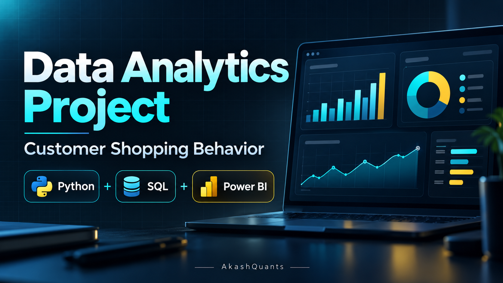
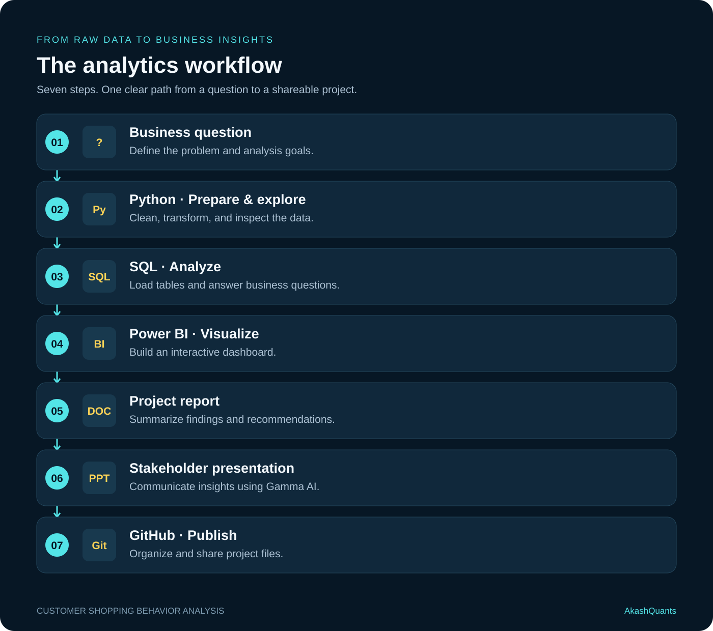

# Customer-Trends-Data-Analysis-SQL-Python-PowerBi
# 👨‍💻 Customer Shopping Behavior Analysis

An end-to-end data analytics portfolio project exploring customer shopping behavior with **Python, SQL, and Power BI**. The workflow moves from preparing raw data to answering business questions, building an interactive dashboard, and communicating findings.

This project brings together:

- **Python and Pandas** for data preparation and exploratory analysis.
- **SQL** for investigating customer segments, purchasing patterns, and loyalty.
- **Power BI** for presenting patterns through interactive visualizations.

## 📌 Project Overview

The goal is to turn customer shopping data into clear findings that can support business decisions.

### Data Preparation, Modeling & Exploratory Analysis · Python

Import the dataset, inspect its structure, address missing values and inconsistencies, and prepare useful fields for analysis. Explore the data to understand customer and purchase patterns.

### Data Analysis · SQL

Load the prepared data into a SQL database and use queries to investigate customer segments, purchase behavior, loyalty, and potential purchase drivers.

### Visualization & Insights · Power BI

Connect the database to Power BI and build an interactive dashboard to explore key measures, compare customer groups, and communicate trends.

### Report & Presentation

Summarize findings, explain their business meaning, and prepare recommendations supported by the analysis. Present the results in a report and stakeholder presentation.

## 🔄 Project Workflow

## 👨‍💻 About the Author

Hi, I'm **Akash Kumar**, an aspiring data specialist from India focused on **data analytics**. I use Python, Pandas, and SQL to understand data, ask useful questions, and explain what I find.

I'm building my skills through practical projects, including retail customer shopping behavior analysis, and sharing my progress as I learn.

**Connect with me:** [GitHub](https://github.com/AkashQuants) · [LinkedIn](https://www.linkedin.com/in/akashchaudharry/) · [Email](mailto:akashchaudharry@outlook.com)
